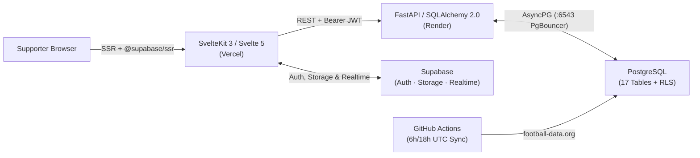

<div align="center">

# GUNNERS

### *Victoria Concordia Crescit* — The Arsenal FC Editorial Portal, Tactical Studio & Statistical Workbench

[](https://gunners-arena.vercel.app)
[](https://gunners-t323.onrender.com/docs)
[](frontEnd/)
[](backEnd/)
[](db/migrations/)

[**Overview**](#overview) · [**The Four Desks**](#the-four-desks) · [**Architecture**](#architecture) · [**Getting Started**](#getting-started) · [**Verification**](#verification--quality-gates) · [**Deployment**](#deployment--automation)

</div>

---

## Overview

**GUNNERS** is a full-stack **Arsenal Football Club fan portal, tactical lineup studio, and statistical intelligence platform**. Designed as a modern broadsheet matchday programme rather than a generic sports feed, it brings together Mikel Arteta-era match archives, live club news, interactive 2D pitch boards, reproducible data queries, and a real-time supporter community inside one cohesive workspace.

The platform is **100% Arsenal-focused** for identity and community membership, while retaining major European and Premier League rivals in its data catalog exclusively for match fixtures and head-to-head Data Lab comparisons. Score predictions are **zero-money supporter games** with strict kickoff locks and automated grading — no gambling or odds feeds are used.

---

## The Four Desks

| Desk | Route(s) | What You Can Do |
| :--- | :--- | :--- |
| **Match Center & Armory Wire** | `/`, `/news`, `/matches`, `/matches/[id]` | Read aggregated Arsenal news from 5 RSS/Atom sources (*Pain in the Arsenal*, *Arseblog*, *BBC Sport*, *Daily Cannon*, `r/Gunners`) with infinite scroll and regex topic tags; explore Arteta-era fixtures & results (`2019/20`–`2026/27`) with goalscorers, lineups, and highlights. |
| **First-Team Squad** | `/squad`, `/squad/[id]` | Browse the 25-player Arsenal first-team directory with portrait-to-action cross-fades, inspect individual scouting dossiers, and compare teammates side by side on per-90 and efficiency metrics. |
| **The Dugout (Tactical Studio)** | `/board` | Arrange starting XIs on an interactive `1000×680` SVG pitch with 6 formation presets, drag-and-drop or keyboard-nudged player tokens, click-to-swap 8-player bench substitutions, `run` / `pass` / `press` vector arrows, `1200×850` PNG matchday export, and saved tactical blueprints. |
| **The Data Lab** | `/lab`, `/lab/historical` | Run reproducible `FINISHED`-match analytics queries (`win_rate`, `clean_sheet_rate`, `goals_per_match`, `points_per_game`, `goal_difference`), inspect multi-season Arteta trends, analyze opponent Head-to-Head records, explore StatsBomb Open Data (ODbL) shot maps, and publish immutable insight snapshots. |
| **The Terrace & Matchday Predictor** | `/terrace`, `/predictions` | Share posts with `#hashtags`, `terrace-media` image uploads, and embedded Data Lab insights or Tactical Boards; cheer, comment, edit/delete your own threads, and submit kickoff-locked score predictions for `All-time` and `Seasonal` leaderboards. |
| **Direct Debates, Notifications & Profiles** | `/messages`, `/notifications`, `/supporters/[username]`, `/profile` | Search supporters, hold 1-on-1 Realtime debates with unread cursors, receive live Realtime alerts (`cheer`, `reply`, `direct_message`, `prediction_result`), sign in with email/password or Google OAuth, and manage your supporter portfolio & avatar. |

> **Editorial Visual System (Hallmark v2.0.0):** Built on an OKLCH charcoal broadsheet palette (`tokens.css` / `base.css` / `app.css`) pairing **Besley** slab-serif headlines, **Hanken Grotesk** body copy, and **JetBrains Mono** tabular numerals with flat hairline ledgers and zero decorative drop-shadows.

---

## Architecture



### Tech Stack

| Layer | Technologies |
| :--- | :--- |
| **Frontend** | SvelteKit 3, Svelte 5 (Runes mode), TypeScript 6, Tailwind CSS v4, Vite 8, `@supabase/ssr` |
| **Backend** | FastAPI, Python 3.11+, SQLAlchemy 2.0 (Async), Pydantic v2, `asyncpg`, `python-jose` (HS256 JWT), `httpx` |
| **Database & Cloud** | Supabase PostgreSQL (17 tables, Row-Level Security, PgBouncer `:6543`), Supabase Auth (Email + Google OAuth), Supabase Storage (`avatars`, `terrace-media`), Supabase Realtime (`direct_messages`, `notifications`) |
| **Testing & Quality** | `pytest` + `pytest-asyncio` (SQLite in-memory), `vitest`, `@playwright/test`, `svelte-check`, Hallmark `sloplint` |

---

## Repository Structure

```text
GUNNERS/
├── .github/workflows/
│   ├── ci.yml                     # Backend pytest + Frontend svelte-check, Vitest, Vite build & Playwright E2E
│   ├── keep-alive.yml             # 3-day cron Supabase ping
│   └── sync-football.yml          # Scheduled 06:00 & 18:00 UTC Arsenal fixture/result sync + prediction grading
├── db/migrations/
│   ├── 001_create_profiles.sql ... 007_create_tactical_boards.sql
│   ├── 008_overhaul_schema_and_rls.sql
│   ├── 009_realtime_and_rls_fixes.sql
│   └── 010_align_orm_text_schema.sql   # Uniform TEXT IDs, strict RLS & OAuth-safe handle_new_user()
├── backEnd/
│   ├── app/
│   │   ├── api/v1/                # 13 FastAPI routers (44 OpenAPI endpoints)
│   │   ├── core/                  # Config, Async SQLAlchemy PgBouncer setup, HS256 JWT verification
│   │   ├── models/                # 17 SQLAlchemy ORM models
│   │   ├── providers/             # football-data.org client (Arsenal ID 57 + 45 fallback matches)
│   │   ├── schemas/               # Pydantic v2 request/response contracts
│   │   ├── scripts/               # seed_community.py (9-stage idempotent seeder), sync_football.py
│   │   └── services/              # AnalyticsEngine, NewsAggregator, Arteta timeline, Ingestion & Grading
│   ├── tests/                     # 15 async pytest test modules (60 tests)
│   ├── .env.example
│   ├── pyproject.toml
│   └── requirements.txt
└── frontEnd/
    ├── src/
    │   ├── lib/                   # API clients, focusTrap action, TacticalBoard, HistoricalPitchExplorer, StateBanner
    │   ├── routes/                # 18 SvelteKit pages + /auth/{callback,reset-password,signout} + +error.svelte
    │   ├── tokens.css / base.css / app.css
    │   └── hooks.server.ts        # @supabase/ssr session & profile hydration
    ├── tests/
    │   ├── unit/                  # Vitest unit suites
    │   └── e2e/                   # Playwright responsive & accessibility E2E specs
    ├── .env.example
    ├── package.json
    └── vite.config.ts             # SvelteKit runes + adapter configuration
```

---

## Getting Started

### Prerequisites

- **Python 3.11+**
- **Node.js 22+** and **npm**
- A **Supabase** project (optional for read-only local SQLite exploration; required for auth, Storage uploads, Realtime DMs/notifications, and PostgreSQL persistence)

### 1. Backend Setup (`backEnd/`)

```bash
cd backEnd
python -m venv .venv
```

Activate the virtual environment:

- **Windows (PowerShell):** `.\.venv\Scripts\Activate.ps1`
- **macOS / Linux:** `source .venv/bin/activate`

Install dependencies and configure environment variables:

```bash
pip install -r requirements.txt
cp .env.example .env
```

Review `backEnd/.env.example` — local SQLite works out of the box, while full auth & Cloud PostgreSQL use:

```env
ENVIRONMENT=development
DEBUG=True
TESTING=False
PORT=8000
HOST=127.0.0.1
ALLOWED_ORIGINS=["http://localhost:5173","http://localhost:4173"]
DATABASE_URL=sqlite+aiosqlite:///./test.db
FOOTBALL_DATA_API_KEY=
SUPABASE_URL=
SUPABASE_KEY=
SUPABASE_JWT_SECRET=
```

Seed the local database and start FastAPI:

```bash
python -m app.scripts.seed_community
python -m app.scripts.sync_football --mock
uvicorn app.main:app --reload --port 8000
```

> API health check: `http://127.0.0.1:8000/api/v1/health` · Interactive OpenAPI docs: `http://127.0.0.1:8000/docs`

### 2. Frontend Setup (`frontEnd/`)

```bash
cd frontEnd
npm install
cp .env.example .env
```

Configure `frontEnd/.env`:

```env
PUBLIC_API_URL=http://localhost:8000/api/v1
PUBLIC_SUPABASE_URL=
PUBLIC_SUPABASE_ANON_KEY=
```

Start the SvelteKit development server:

```bash
npm run dev
```

Open `http://localhost:5173` in your browser.

---

## Verification & Quality Gates

Run the full verification suite locally from the repository root:

```bash
# Backend unit & API integration tests (60 async tests on SQLite :memory:)
pytest backEnd/tests -v

# Frontend typecheck, unit tests (16 tests), production build & Playwright E2E (19 tests)
npm --prefix frontEnd run check
npm --prefix frontEnd run test:unit
npm --prefix frontEnd run build
npm --prefix frontEnd run test:e2e
```

---

## Deployment & Automation

| Surface | Host / Service | Notes |
| :--- | :--- | :--- |
| **Frontend** | Vercel (`gunners-arena.vercel.app`) | Uses `@sveltejs/adapter-vercel` on Vercel/Linux builds via `frontEnd/vite.config.ts`. |
| **Backend API** | Render (`gunners-t323.onrender.com`) | Runs FastAPI via `backEnd/Procfile`; connects to Supabase over IPv4 PgBouncer (`:6543`, `statement_cache_size=0`). |
| **Database, Auth, Storage & Realtime** | Supabase | Schema managed via `db/migrations/001..010.sql`; Realtime enabled on `direct_messages` and `notifications`. |
| **CI/CD & Cron** | GitHub Actions | `.github/workflows/ci.yml` gates merges with pytest + Svelte check/Vitest/build/Playwright; `sync-football.yml` syncs Arsenal matches twice daily (`06:00` / `18:00` UTC) and auto-grades finished match predictions. |

---

<div align="center">

Built for Arsenal supporters · **GUNNERS**

</div>
